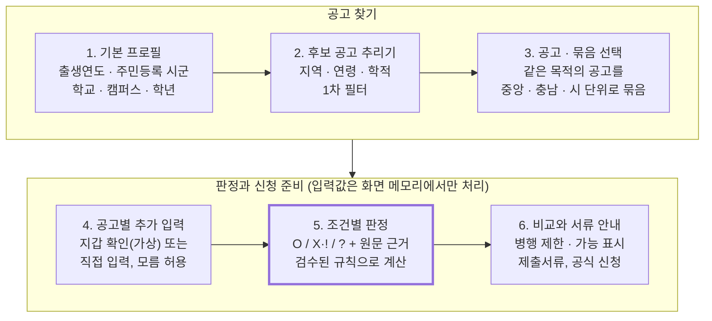
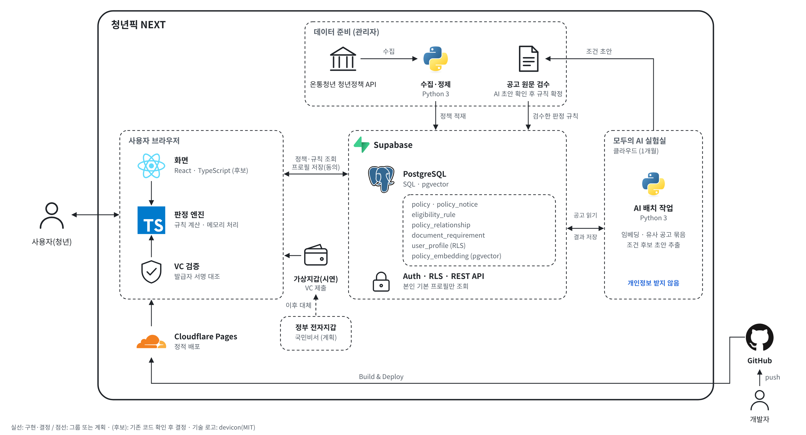

<div align="center">
  <h1>청년픽 NEXT</h1>
  <p>
    <strong>천안·아산 청년 맞춤형 AI 정책 실행 내비게이터</strong><br>
    비슷한 청년정책을 묶어 비교하고, 조건마다 O / X / ? 와 공고 원문 근거를 보여준 뒤 신청 서류까지 안내합니다.
  </p>
  <p>2026 마이 AI랩(모두의AI라운지@천안) · 모두의 AI 충남</p>
</div>

> **2026-11-11 기준** 기획과 데이터 준비는 마쳤고, 판정 규칙과 화면은 구현 전입니다.<br>
> 이 문서는 상태를 구분해 적습니다. **구현** = 실제로 동작, **시연(가상)** = 가상 데이터로 시연, **계획** = 아직 만들지 않음, **가설** = 측정 전 기대효과.

<br>

<details open>
<summary><strong>&nbsp;📖&nbsp;목차</strong></summary>

1. [🔍 Introduction](#-introduction)
2. [🧭 주요 기능 (MVP 범위)](#-주요-기능-mvp-범위)
3. [🔄 User Flow](#-user-flow)
4. [💡 Tech Stack](#-tech-stack)
5. [💻 Architecture](#-architecture)
6. [🗂 Database (설계)](#-database-설계)
7. [🔐 개인정보 원칙](#-개인정보-원칙)
8. [📊 Data](#-data)
9. [📌 진행 상황](#-진행-상황)
10. [📅 일정](#-일정)
11. [👥 Team](#-team)

</details>

<br>

## 🔍 Introduction

### 배경

천안·아산에서 공부하거나 일하는 청년은 주민등록지, 재학지, 부모 거주지가 서로 달라서 어떤 정책을 신청할 수 있는지 판단하기 어렵습니다.<br>
비슷한 정책 중 무엇을 고르고 무엇을 함께 받을 수 있는지도 공고마다 흩어져 있습니다.

| 어려움 | 공고에서 확인한 예 |
|---|---|
| 거주 기준이 제각각 | 본인 주민등록(천안 자격증 응시료), 본인 또는 부모 1년 이상(충남·천안·아산 학자금 이자 지원), 부모 3년 이상(아산 희망장학금) |
| 주민등록 없이 재학으로 가능한 정책 | 천안·아산 면접정장 대여는 관내 대학 재학만으로 신청 가능 |
| 함께 받기 제한이 흩어짐 | 충남 전세이자: 유사 대출이자 사업 지원 중이면 불가. 미래내일 일경험과 국민취업지원제도는 참여수당 중 하나만 |
| 조건 표현이 복잡 | 청년가구·원가구 중위소득, 학자금 지원구간, 병역 기간만큼 연령 상한 연장 |

**대상** : 천안·아산 생활권 대학생·취업준비생 (주민등록지는 전국 어디든 가능)<br>
**다루는 정책** : 중앙정부 · 충청남도 · 천안시 · 아산시

### 특징

- **유사 공고 묶음과 비교**&nbsp;:&nbsp;&nbsp;학자금 이자, 장학, 주거, 구직 등 같은 목적의 중앙·충남·천안·아산 정책을 한눈에 비교
- **함께 받을 수 있는지 검토**&nbsp;:&nbsp;&nbsp;원문의 제한·허용 문구를 근거로 "병행 제한 / 병행 가능 / 추가 확인"으로 표시
- **생활권 판정**&nbsp;:&nbsp;&nbsp;주민등록지, 재학 캠퍼스, 부모 주민등록을 따로 대조
- **최소 수집**&nbsp;:&nbsp;&nbsp;서버에는 기본 정보만, 판정에 필요한 세부 값은 화면 메모리에서만 처리

> 기존 서비스(온통청년, 웰로 등)에도 맞춤 추천과 자격진단이 있습니다. 차별점은 추천 자체가 아니라 함께 검토할 공고를 묶고 그 사이의 관계를 근거와 함께 보여주는 데 있습니다. 이것이 사용자에게 충분한 가치인지는 아직 검증 전입니다(가설).

<br>

## 🧭 주요 기능 (MVP 범위)

이번 MVP는 **정책 묶음 하나를 처음부터 끝까지**(후보 추리기, 판정, 비교, 서류 안내) 완성하는 것이 목표입니다. 나머지 후보 정책은 목록과 원문 링크만 보여줍니다.

| 기능 | 이번 MVP | 이후 단계 |
|---|---|---|
| 정책 후보 추리기 | 기본 프로필 10개 항목으로 후보 정책 필터 | 후보 전체 규칙화 |
| 조건별 판정 (O / X / ?) | 묶음 1개(예: 학자금 이자 지원 4건)의 검수된 규칙 | 나머지 묶음으로 확대 |
| 묶음 비교·병행 검토 | 같은 묶음 안의 비교표와 병행 근거 표시 | 묶음 간 관계(선행·후속 정책) |
| 신청 서류 안내 | 공고별 제출서류 체크리스트와 발급 경로 | 준비 상태·마감 관리 |
| 전자지갑 증명 | 가상지갑으로 DID 기반 검증가능 증명(VC) 시연(가상) | 정부 전자지갑 실제 연동(정부사업) |
| AI 공고 처리 | 유사 공고 묶음(임베딩), 조건 후보 초안(사람 검수 필수) | 새 공고 반자동 등록 |

MVP 완료 기준은 버튼이 있는지가 아니라, **정해진 가상 입력에서 예상한 판정이 나오고** 사용자가 다음 행동(서류 준비, 공식 신청 페이지)까지 갈 수 있는지입니다.

### 판정 표시

판정은 AI가 아니라 **사람이 검수한 규칙**이 합니다.

| 표시 | 뜻 | 하지 않는 해석 |
|:---:|---|---|
| O | 입력값이 검수된 조건을 충족 | 실제 선정·지급 보장 |
| X + ! | 조건 미충족과 그 이유 | OR·예외 확인 없는 전체 탈락 |
| ? | 미입력·모름·근거 부족·추가 확인 | O 또는 X로 자동 변환 |

조건마다 값의 출처도 함께 표시합니다: **지갑 확인**(발급기관 서명, 이번에는 가상) / **직접 입력**(서류의 어느 칸을 보는지 안내) / **신청기관 확인**(서류나 입력으로 판단할 수 없는 조건).

<br>

## 🔄 User Flow



> 4·5단계 입력값은 서버에 저장하지 않습니다.

<br>

## 💡 Tech Stack

|Frontend|Backend · DB|Data · AI|Infra|Collaboration|
|:------:|:------:|:------:|:------:|:------:|
|<br>|<br><br>||||

```
- Frontend   : React (후보), TypeScript, Web Crypto API (가상지갑 서명 검증, 후보)
- Backend    : Supabase (PostgreSQL, Auth, RLS, REST API), SQL
- Database   : PostgreSQL + pgvector (유사 공고 검색)
- Data / AI  : Python 3 (온통청년 API 수집·정제, 임베딩·조건 후보 초안 배치 작업)
- Deployment : Cloudflare Pages (화면), 모두의 AI 실험실 클라우드 (AI 배치, 이용기간 1개월)
- Tool       : GitHub (기능별 브랜치 -> PR -> main)

(후보) = 기존 코드 확인 후 결정
```

<br>

## 💻 Architecture

### System



```
- 데이터 준비 : 온통청년 청년정책 API -> Python 수집·정제 -> Supabase 적재
- AI 배치 작업 : 모두의 AI 실험실 클라우드에서 공개 공고만 읽어 임베딩·유사 공고 묶음, 조건 후보 초안을 저장
- 규칙 검수 : AI 초안을 사람이 공고 원문과 대조해 확정한 것만 판정 규칙이 됨
- 사용자 브라우저 : 화면(React, 후보) + 판정 엔진(TypeScript). 공고별 세부 입력과 VC 검증 결과는 서버로 보내지 않음
- DB·인증·API : Supabase. 사용자 요청을 받는 별도 백엔드 서버는 두지 않음
- 가상지갑 : DID 기반 검증가능 증명(VC) 시연. 정부사업 단계에서 정부 전자지갑으로 대체(계획)
- 배포 : GitHub push -> Cloudflare Pages 정적 배포
```

구조도 원본은 [`docs/architecture.drawio`](docs/architecture.drawio)이며 [diagrams.net](https://app.diagrams.net)에서 열어 고칠 수 있습니다. 기술 로고는 [devicon](https://devicon.dev)(MIT)을 사용했습니다.

<details>
<summary><strong>스택 선택 이유</strong></summary>
<br>

- **DB는 MySQL 대신 PostgreSQL(Supabase)** : 공고마다 형태가 다른 판정 규칙을 `jsonb`로 저장하고, RLS로 본인 데이터만 보이게 하며, pgvector로 유사 공고를 DB 안에서 찾습니다.
- **서버는 역할별로 나눔** : 화면은 Cloudflare Pages, DB·인증·API는 Supabase, AI 배치 작업은 모두의 AI 실험실 클라우드에서 돌립니다.
- **실험실 클라우드** : 이용기간이 1개월 고정입니다. 외부 공개 주소를 열 수 있는지는 확인하지 못했지만, 배치 작업은 외부 접속을 받지 않으므로 필요 없습니다. 시연 뒤에도 운영하면 AWS 등으로 옮깁니다.
- **AI 역할** : 클릭·신청 이력 같은 사용 데이터가 아직 없어 추천 모델은 학습시키지 않습니다. AI는 공개 공고 데이터로 유사 공고 묶음과 조건 후보 초안만 만들고, 판정은 검수된 규칙으로 브라우저에서 합니다. 사용할 모델은 미정입니다.

</details>

<br>

## 🗂 Database (설계)

> 아래는 설계안입니다. 테이블은 아직 만들지 않았습니다(계획).

| 테이블 | 내용 | 비고 |
|---|---|---|
| `policy` · `policy_notice` | 정책과 연도별 공고 | 공개 정보, 출처·수집일 기록 |
| `eligibility_rule` | 검수된 판정 규칙 | `jsonb`, 사람이 원문 검수 후 등록 |
| `policy_relationship` | 정책 간 관계: 병행 제한 / 병행 가능 / 조건부 병행 / 선행조건 / 추가 확인 | 원문 문구를 근거로 기록 |
| `document_requirement` | 공고별 제출서류와 발급 경로 | |
| `user_profile` | 기본 프로필 10개 항목 | 동의 시 저장, RLS로 본인만 조회 |
| `policy_embedding` | 공고 임베딩 | pgvector, AI 배치 작업이 저장 |

<details>
<summary><strong>개인화 항목 69개 처리 방식</strong></summary>
<br>

| 구분 | 항목 수 | 처리 | 예 |
|---|:---:|---|---|
| 기본 저장 | 10 | 동의 시 서버 저장 | 출생연도, 주민등록 시·군, 재학 학교·캠퍼스, 학년 |
| 공고별 일시 입력 | 49 | 해당 공고 화면 메모리에서만 처리 | 성적, 학자금 지원구간, 월세액, 부모 주민등록 |
| 보류 | 4 | 받지 않음(필요 시 재검토) | 주민등록 구·동, 전공 계열 |
| 수집 제외 | 6 | 어떤 경우에도 받지 않음 | 주민등록번호, 상세 주소, 증빙 원본, 재산 금액 |

가구소득·재산은 금액을 받지 않고 "기준 이하인가"를 예 / 아니오 / 모름으로 묻습니다.

</details>

<br>

## 🔐 개인정보 원칙

**"청년픽이 가지지 않은 정보는 새지 않는다"**

| 데이터 | 처리 위치 | 원칙 |
|---|---|---|
| 기본 프로필 10개 | Supabase (동의 시) | RLS로 본인만 조회 |
| 공고별 일시 입력 49개 | 브라우저 메모리 | 서버·로그·URL·분석도구·외부 AI로 보내지 않음 |
| 증빙 서류 원본 | 사용자 전자지갑 | 청년픽은 받지 않음 |
| 지갑 증명 결과 | 브라우저 메모리 | "천안 주민등록 1년 이상: 예" 같은 사실과 발급기관 서명만 사용 |
| 정책·규칙·서류 안내 | Supabase | 공개 정보, 출처·수집일 기록 |

- 블록체인은 문서 저장이 아니라 **발급기관 공개키와 폐기 여부 확인**에만 씁니다. 개인정보는 블록체인에 기록하지 않습니다.
- 부모 조건은 "부모 중 한 분이 해당 지역에 1년 이상 주민등록돼 있나요? 예 / 아니오 / 모름"으로만 묻고, 부모의 이름이나 주소는 받지 않습니다.
- AI 배치 작업에는 개인정보를 보내지 않습니다.
- API 키 같은 비밀값은 `.env`로만 관리하고 저장소에 올리지 않습니다.

<br>

## 📊 Data

| 데이터 | 규모 | 출처 | 상태 |
|---|---|---|---|
| 온통청년 청년정책 API 수집본 | 3,969건 (분석 대상 721건) | 온통청년 청년정책 API, 2026-11-09 수집 | 구현 (수집 스크립트) |
| 정책 후보 1차안 | 28건 (묶음 8개), 예비 10건 | 공고 원문 조사 + API 대조 | 확정 전 |
| API 검토 후보 | 36건 | API 천안·아산 지역 정책 + 묶음 보강용 | 추가 여부 결정 전 |
| 정책 간 관계 근거 | 25건 + API에서 추가 확인 1건 | 공고·기관 안내 원문 문구 | 원문 검수 전 |
| 개인화 항목 v0.3 | 69개 | 1차안 조건 + API 실측 | 초안 |
| 항목별 확인서류 | 서류 39종 | 발급기관 공식 안내 | 초안 |
| 판정 규칙 | 0건 | 공고 원문 검수 후 작성 | 계획 |

API 데이터에서 확인한 한계: 연령 값은 52.7%, 취업·학력 코드는 약 30% 정책에만 실제 조건이 들어 있습니다. 부모 주민등록·거주 기간 요건은 API 문구에 각 2건뿐이라, 판정 규칙은 공고 원문을 검수해 만듭니다. 천안은 지역코드 44130과 44131·44133을 모두 천안으로 묶어 매칭합니다.

<br>

## 📌 진행 상황

**2026-11-11 기준**

- [x] 온통청년 API 수집 스크립트와 수집본 3,969건
- [x] API 매칭표와 데이터 품질 메모 11개
- [x] 개인화 항목 v0.3 (69개, 초안)
- [x] 항목별 확인서류표 (서류 39종, 초안)
- [x] 기획서와 시스템 구조도
- [ ] 기존 코드 확인 (프레임워크, 실행 방법, 동작 기능)
- [ ] 정책 최종 목록 확정 (1차안 28건 + API 검토 후보 36건)
- [ ] 시연 묶음 1개 선택과 공고 원문 검수
- [ ] 판정 규칙·제출서류 데이터 작성
- [ ] Supabase 테이블 생성과 RLS 설정
- [ ] 화면: 정책 상세, 추가 입력, 판정, 서류 안내, 비교
- [ ] 가상지갑 증명 최소 구현
- [ ] AI 배치 작업 (임베딩·유사 공고 묶음, 조건 후보 초안)
- [ ] 가상 사례 정답셋과 사용자 테스트

<details>
<summary><strong>측정 전 가설</strong></summary>
<br>

- 묶음 비교가 단순 목록보다 선택을 돕는다.
- 기본 정보만 저장해도 입력 부담이 받아들여진다.
- 원문 근거와 O / X / ? 표시가 조건 오해를 줄인다.

</details>

<br>

## 📅 일정

| 일정 | 날짜 |
|---|---|
| 멘토링 3회차 | 2026-11-10 ~ 11-13 |
| 데이터·AI 과정 | 2026-11-13 |
| 멘토링 4회차 (검수) | 2026-11-16 ~ 11-20 |
| 최종 결과물 제출 | 2026-11-23 ~ 11-25 |
| **최종 발표·시연** | **2026-11-30** |

마이 AI랩 중간 점검 안내문 기준입니다.

<br>

## 👥 Team

| [김주완](https://github.com/NFULL07) |
|:---:|
|  |
| 기획 · 구조설계 · PO · AI · BE|

| [안준모](https://github.com/NFULL07) |
|:---:|
|  |
| 기획 · FE |

| [이해찬](https://github.com/fullofsun9-png) |
|:---:|
|  |
| UI · UX |

<!--
팀원 추가 예시 (열을 늘려 쓰기)
| [이름](https://github.com/아이디) | [이름](https://github.com/아이디) |
|:---:|:---:|
|  |  |
| 역할 | 역할 |
-->

> 공식 출처 조사, API 데이터 분석, 문서 초안에 AI(Claude)를 활용했습니다. 정책 선정 기준, 판정 규칙 확정, 원문 검수는 사람이 합니다.

<!--
구현이 진행되면 추가할 것
- 📹 Demo: 시연 화면 캡처 또는 GIF
- 배포 주소 (Cloudflare Pages)
- ERD 이미지 (Supabase 테이블 생성 후)
- 📂 Directory Structure (코드 구조 확정 후)
- 실행 방법 (로컬 실행, .env 예시)
- 결과: 판정 정확도 등 실제 측정값 (가설과 구분해 기록)
-->
