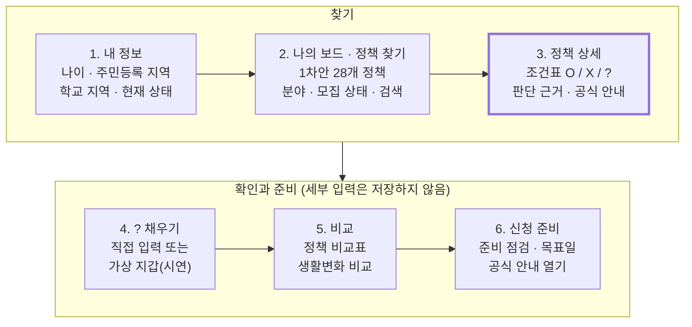
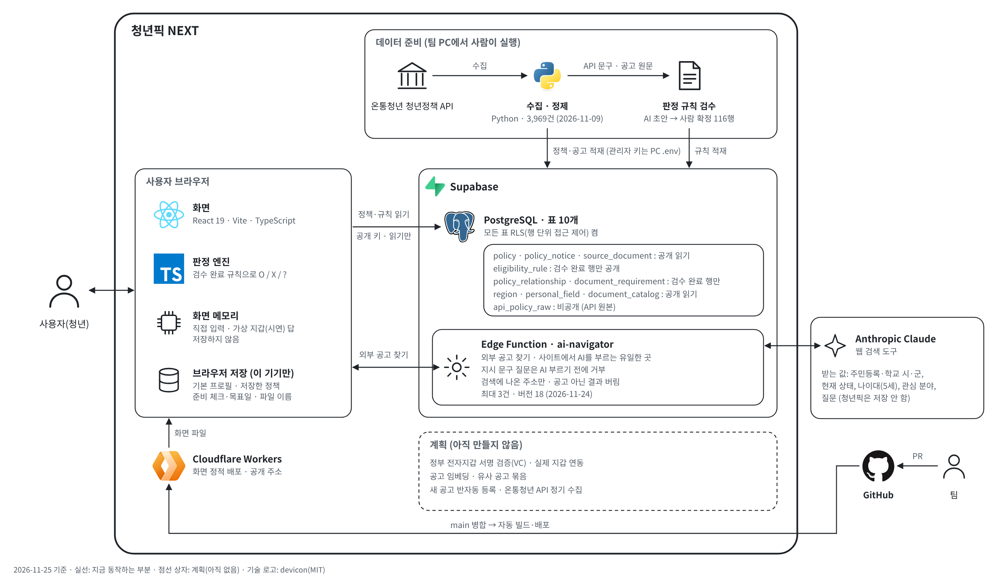

<div align="center">
  <h1>청년픽 NEXT</h1>
  <p>
    <strong>천안·아산 청년 맞춤형 AI 정책 실행 내비게이터</strong><br>
    비슷한 청년정책을 묶어 비교하고, 조건마다 O / X / ? 와 판단 근거를 보여준 뒤 신청 준비까지 안내합니다.
  </p>
  <p>2026 마이 AI랩(모두의AI라운지@천안) · 모두의 AI 충남</p>
  <p><a href="https://youthpick-next.kjoun1108.workers.dev/"><strong>공개 시연 사이트 열기</strong></a></p>
</div>

> **2026-11-25 기준** 공개 시연 사이트가 동작합니다. 1차안 28개 정책 중 22개는 사람이 검수한 판정 규칙 116행으로 조건마다 O / X / ? 를 보여줍니다. 판정 정확도와 사용자 효과는 아직 측정하지 않았습니다.<br>
> 상태 표기: **구현** = 실제로 동작 · **시연(가상)** = 가상 데이터로 시연 · **초안** = 사람 검수 전이라 화면에 나오지 않음 · **계획** = 아직 만들지 않음 · **가설** = 측정 전 기대효과

<br>

<details open>
<summary><strong>&nbsp;📖&nbsp;목차</strong></summary>

1. [🔍 Introduction](#-introduction)
2. [🧭 주요 기능](#-주요-기능)
3. [📐 판정 방식](#-판정-방식)
4. [🔄 User Flow](#-user-flow)
5. [💡 Tech Stack](#-tech-stack)
6. [💻 Architecture](#-architecture)
7. [🗂 Database](#-database)
8. [🔐 개인정보 처리](#-개인정보-처리)
9. [📊 Data와 검수](#-data와-검수)
10. [✅ 결과와 남은 검증](#-결과와-남은-검증)
11. [🚀 실행과 배포](#-실행과-배포)
12. [📅 진행 기록](#-진행-기록)
13. [👥 Team](#-team)

</details>

<br>

## 🔍 Introduction

### 배경

천안·아산에서 공부하거나 일하는 청년은 주민등록지, 재학지, 부모 거주지가 서로 달라서 어떤 정책을 신청할 수 있는지 판단하기 어렵습니다.<br>
비슷한 정책 중 무엇을 고르고 무엇을 함께 받을 수 있는지도 공고마다 흩어져 있습니다.

| 어려움 | 공고에서 확인한 예 |
|---|---|
| 거주 기준이 제각각 | 본인 주민등록(천안 자격증 응시료), 본인 또는 부모 1년 이상(충남·천안·아산 학자금 이자 지원), 부모 3년 이상(아산 희망장학금) |
| 주민등록 없이 재학으로 가능한 정책 | 천안·아산 면접정장 대여는 관내 대학 재학만으로 신청 가능 |
| 함께 받기 제한이 흩어짐 | 미래내일 일경험과 국민취업지원제도는 참여수당 중 하나만 |
| 조건 표현이 복잡 | 청년가구·원가구 중위소득, 학자금 지원구간, 병역 기간만큼 연령 상한 연장 |

**대상** : 천안·아산 생활권 대학생·취업준비생 (주민등록지는 전국 어디든 가능)<br>
**다루는 정책** : 중앙정부 · 충청남도 · 천안시 · 아산시 정책 중 1차안 28개 (같은 목적끼리 8개 묶음)

### 특징

- **유사 공고 묶음과 비교**&nbsp;:&nbsp;&nbsp;학자금 이자, 장학, 주거, 구직 등 같은 목적의 정책을 묶고 표로 비교 (구현)
- **생활권 판정**&nbsp;:&nbsp;&nbsp;주민등록지, 재학지, 부모 주민등록을 따로 묻고 "둘 중 하나" 조건을 묶어서 판정 (구현)
- **근거와 함께 판정**&nbsp;:&nbsp;&nbsp;조건마다 판단 근거 문장과 출처 링크, 모르는 값은 ? 로 둠 (구현)
- **서버에 개인정보를 두지 않음**&nbsp;:&nbsp;&nbsp;내 정보는 이 기기 브라우저에만, 공고별 세부 입력은 화면 메모리에서만 처리 (구현)
- **함께 받을 수 있는지 검토**&nbsp;:&nbsp;&nbsp;원문 문구로 "병행 제한 / 조건부 병행 / 추가 확인" 표시 (초안 17행, 사람 검수 전이라 화면에 나오지 않음)

> 기존 서비스(온통청년, 웰로 등)에도 맞춤 추천과 자격진단이 있습니다. 차별점은 추천 자체가 아니라 함께 검토할 공고를 묶고 생활권 조건을 나눠 근거와 함께 보여주는 데 있습니다. 이것이 사용자에게 충분한 가치인지는 아직 검증 전입니다(가설).

<br>

## 🧭 주요 기능

| 화면 | 하는 일 | 상태 |
|---|---|---|
| 내 정보 | 나이, 주민등록 지역, 학교 지역, 근무 지역, 현재 상태, 관심 분야 입력 | 구현 |
| 나의 보드 | 내 조건 요약, 다음에 할 일, 비교 담기 | 구현 |
| 정책 찾기 | 1차안 28개 정책을 분야·모집 상태·검색으로 찾기, 저장, 12개씩 보기 | 구현 |
| 정책 상세 | 조건표 O / X / ?, 판단 근거와 출처 링크, 공식 안내 링크(신청 페이지·안내 페이지) | 구현 (검수 규칙이 있는 22개 정책) |
| 직접 입력 | 판정에 필요한 세부 값을 직접 고르고, 확인할 서류(지갑 밖 서류 14종 포함)를 안내 | 구현 (저장하지 않음) |
| 정책 비교 | 담은 정책을 분류·모집 상태·지원 내용·서류 안내로 나란히 비교 | 구현 |
| 생활변화 비교 | 지역·학적·취업 상태를 바꿔 보고 다시 살펴볼 정책을 비교 (예시: 졸업 후 구직, 천안으로 전입, 졸업 + 천안 전입) | 구현 |
| 신청 준비 | 준비 점검 체크리스트, 나의 준비 목표일, 공식 안내 열기 | 구현 |
| 전자지갑 | 가상 인물 3명의 서류 사실로 판정과 직접 입력을 미리 채움. 서류 파일은 이름만 기록 | 시연(가상) |
| AI 내비게이터: 정책 안내 | 키워드별로 정해진 답을 보여주는 규칙형 안내 (AI를 부르지 않음) | 구현 |
| AI 내비게이터: 외부 공고 찾기 | 온통청년 밖 민간·재단·기업·대학 공고를 AI 웹 검색으로 찾고, O/X 없이 'AI 추천 · 조건 확인 필요'로 표시 | 구현 (품질·비용 평가 전) |
| 개인정보 처리 안내 | 화면 맨 아래에 지금 배포가 실제로 하는 일을 적음 | 구현 (법률 검토 전) |

<br>

## 📐 판정 방식

판정은 AI가 아니라 **사람이 검수한 규칙**으로 브라우저 안에서 계산합니다.

| 화면 표시 | 뜻 | 하지 않는 해석 |
|:---:|---|---|
| O · 충족 가능 | 입력값이 검수된 조건을 충족 | 실제 선정·지급 보장 |
| X · 조건 불일치 | 입력값이 조건과 맞지 않음 | 예외·"둘 중 하나" 확인 없는 전체 탈락 |
| ? · 추가 확인 | 미입력·모름·근거 부족 | O 또는 X로 자동 변환 |

- 판정 엔진은 검수 완료(`reviewed`) 규칙만 씁니다. 초안·반려 규칙은 DB 접근 규칙(RLS) 때문에 화면으로 오지 않습니다.
- "본인 또는 부모 주민등록", "거주 또는 재학" 같은 조건은 한 묶음으로 판정합니다. 검수 완료 116행 중 59행이 이런 묶음에 속합니다.
- 모르는 사실은 '아니오'로 채우지 않고 ? 로 둡니다.
- 조건마다 공고 문장(판단 근거)과 출처 링크를 함께 보여줍니다.

<br>

## 🔄 User Flow



> 어느 화면에서든 AI 내비게이터를 열어 정책 안내(규칙형)나 외부 공고 찾기(AI)를 쓸 수 있습니다.

<br>

## 💡 Tech Stack

|Frontend|Backend · DB|AI|Data|Infra · Tool|
|:------:|:------:|:------:|:------:|:------:|
|<br><br><br>|<br>|<br>||<br>|

```
- Frontend   : React 19, Vite 8, TypeScript, Tailwind CSS 4, lucide-react, motion
- Backend    : Supabase (PostgreSQL 17, RLS, REST API). 사용자 요청을 받는 별도 백엔드 서버는 없음
- AI         : Supabase Edge Function (Deno) + Anthropic Claude 웹 검색 도구. 외부 공고 찾기에서만 호출
- Data       : Python 3 표준 라이브러리 (온통청년 API 수집, Supabase 적재, 확인서류표 -> 화면 데이터 생성)
- Test       : tsx --test (웹 113개), tsc 타입 검사, unittest (파이프라인 53개)
- Deployment : Cloudflare Workers (GitHub main 병합 시 자동 빌드·정적 배포)
- Tool       : GitHub (기능별 브랜치 -> PR -> main), AI 코딩 도구
```

<br>

## 💻 Architecture



- **데이터 준비** : 팀 PC에서 사람이 실행합니다. 온통청년 API 3,969건 수집(2026-11-09, 1회) -> 정제 -> Supabase 적재. 적재용 관리자 키는 그 PC의 `.env`에만 둡니다.
- **규칙 검수** : AI가 API 문구·공고 원문으로 규칙 초안을 만들고, 별도 AI 교차검증 뒤 사람이 검수·확정합니다. 검수 완료(`reviewed`) 행만 화면에 공개됩니다.
- **브라우저** : 화면이 공개 키로 Supabase를 읽기만 합니다. 판정 엔진은 브라우저 안에 있고, 직접 입력·가상 지갑 답은 메모리에만, 내 정보·저장 목록은 이 기기 localStorage에만 둡니다.
- **Supabase** : PostgreSQL 표 10개, 모든 표 RLS. 사용자 개인정보를 담는 표는 없습니다.
- **외부 공고 찾기** : 화면 -> Edge Function `ai-navigator` -> Anthropic Claude 웹 검색. 지시 문구 질문은 AI 호출 전에 거부하고, 검색에 나온 주소만 쓰며, 공고가 아닌 결과는 버리고, 최대 3건만 돌려줍니다.
- **배포** : GitHub main 병합 -> Cloudflare Workers가 빌드·정적 배포합니다.
- **계획(점선)** : 정부 전자지갑 서명 검증(VC), 공고 임베딩·유사 공고 묶음, 새 공고 반자동 등록·API 정기 수집

<details>
<summary><strong>처음 설계(2026-11-11)에서 바뀐 점</strong></summary>
<br>

| 처음 설계 | 지금 |
|---|---|
| Cloudflare Pages | Cloudflare Workers (2026-11-22 Worker로 만들어 GitHub와 연결) |
| 화면 React (후보) | React 19 + Vite + TypeScript |
| 모두의 AI 실험실 클라우드에서 AI 배치(임베딩, 조건 초안) | 만들지 않음. 규칙 초안·교차검증은 작업 중에 AI 도구로 하고 사람이 확정 |
| pgvector, `policy_embedding` | 만들지 않음 (계획) |
| Supabase Auth, `user_profile` (동의 시 기본 프로필 저장) | 만들지 않음. 내 정보는 이 기기 브라우저에만 |
| 가상지갑 서명 검증(VC, Web Crypto) | 가상 인물 3명의 사실로 답을 채우는 시연만. 서명 검증은 계획 |
| 없음 | 외부 공고 찾기 (Edge Function + Anthropic 웹 검색) |

모두의 AI 실험실 게이트웨이는 Supabase 서버에서 연결되지 않아(2026-11-23 진단) 배포에는 쓰지 않았습니다.

</details>

<br>

## 🗂 Database

Supabase PostgreSQL에 표 10개를 만들고 모두 RLS(행 단위 접근 제어)를 켰습니다. 화면은 공개 키로 읽기만 합니다. 행 수는 2026-11-25 조회 기준입니다.

| 표 | 내용 | 행 수 | 화면 공개 |
|---|---|---:|---|
| `policy` | 정책 (1차안 28, 예비 10, 제외 3) | 41 | 공개 읽기 |
| `policy_notice` | 연도별 공고 (API 26, API에 없는 공고 7) | 33 | 공개 읽기 |
| `source_document` | 근거 출처 (공고 원문, 기관 안내, 기사 등) | 65 | 공개 읽기 |
| `eligibility_rule` | 판정 규칙 (검수 완료 116, 초안 37, 반려 8) | 161 | 검수 완료 행만 |
| `policy_relationship` | 정책 간 관계 (추가 확인 11, 조건부 병행 4, 병행 제한 1, 선행조건 1) | 17 | 검수 완료 행만 (지금 0행) |
| `document_requirement` | 공고별 제출서류 (6개 정책) | 25 | 검수 완료 행만 (지금 0행) |
| `personal_field` | 개인화 항목 정의 (값이 아니라 항목 목록) | 69 | 공개 읽기 |
| `document_catalog` | 확인서류 종류 | 39 | 공개 읽기 |
| `region` | 지역 코드 (충청남도, 천안시, 천안시 동남구·서북구, 아산시) | 5 | 공개 읽기 |
| `api_policy_raw` | 온통청년 API 원본 | 3,969 | 비공개 |

- 검수 완료 규칙은 출처 문서와 검수자·검수일이 있어야 저장됩니다(DB 제약 조건).
- 스키마: `supabase/migrations/`, 점검 SQL: `supabase/checks/schema_checks.sql`, 설명: `docs/handoff/supabase_schema.md`

<br>

## 🔐 개인정보 처리

**"청년픽이 가지지 않은 정보는 새지 않는다"**

| 데이터 | 어디에 | 원칙 |
|---|---|---|
| 내 정보 (나이, 지역, 현재 상태, 관심 분야) | 이 기기 브라우저 (localStorage) | 서버에 저장하지 않음 |
| 저장한 정책, 준비 목록·체크·목표일, 기록한 파일 이름 | 이 기기 브라우저 (localStorage) | 파일 내용은 읽지 않음 |
| 직접 입력 값, 가상 지갑 답 | 화면 메모리 | 저장·전송하지 않음 |
| 외부 공고 찾기 요청 | Supabase Edge Function -> Anthropic | 아래 6가지만 보냄, 청년픽은 저장하지 않음 |
| 정책·규칙·출처 | Supabase | 공개 정보 |

- 외부 공고 찾기가 보내는 값: 주민등록 지역(시·군), 학교 지역(시·군), 현재 상태, 나이대(5세 단위), 관심 분야, 질문. 정확한 나이·학교 이름·공고별 세부 입력은 보내지 않습니다. 함수가 남기는 로그에는 질문을 넣지 않고 결과 건수·진단 값·걸린 시간만 적습니다.
- 부모 조건은 "부모 중 한 분이 해당 지역에 1년 이상 주민등록돼 있나요? 예 / 아니오 / 모름"으로만 묻고, 부모의 이름이나 주소는 받지 않습니다.
- 화면 맨 아래 '개인정보 처리 안내'에 위 내용을 적어 두었습니다(초안, 법률 검토 전: `docs/handoff/privacy_notice_draft.md`).
- API 키 같은 비밀값은 `.env`와 Supabase 비밀값으로만 관리하고 저장소에 올리지 않습니다.

<details>
<summary><strong>개인화 항목 69개 설계</strong></summary>
<br>

| 구분 | 항목 수 | 처리 | 예 |
|---|:---:|---|---|
| 기본 정보 | 10 | 설계는 동의 시 서버 저장. 지금 배포는 서버 저장 없이 브라우저에만 | 출생연도, 주민등록 시·군, 재학 학교·캠퍼스, 학년 |
| 공고별 일시 입력 | 49 | 해당 공고 화면 메모리에서만 처리 | 성적, 학자금 지원구간, 월세액, 부모 주민등록 |
| 보류 | 4 | 받지 않음(필요 시 재검토) | 주민등록 구·동, 전공 계열 |
| 수집 제외 | 6 | 어떤 경우에도 받지 않음 | 주민등록번호, 상세 주소, 증빙 원본, 재산 금액 |

가구소득·재산은 금액을 받지 않고 "기준 이하인가"를 예 / 아니오 / 모름으로 묻습니다.

</details>

<br>

## 📊 Data와 검수

| 데이터 | 규모 | 출처 | 상태 |
|---|---|---|---|
| 온통청년 청년정책 API 원본 | 3,969건 (분석 대상 721건) | 온통청년 청년정책 API, 2026-11-09 1회 수집 | 구현 (정기 수집 없음) |
| 정책 1차안 | 28개 (8개 묶음), 공고 33건 | 공고 원문 조사 + API 대조. API에 없는 7개(A4 B4 B5 E1 E2 E3 H1)는 원문으로 등록 | 화면에 표시 |
| 판정 규칙 | 161행: 검수 완료 116, 초안 37, 반려 8 | API 문구 + 출처 원문 대조 + 별도 AI 교차검증 + 사람 검수 | 검수 완료 22개 정책에 적용 |
| 정책 간 관계 | 17행 | 공고·기관 안내 문구 | 초안 (화면에 안 나옴) |
| 공고별 제출서류 | 25행 (6개 정책) | 온통청년 API 제출서류 문구 | 초안 (화면에 안 나옴) |
| 개인화 항목 | 69개 | 1차안 조건 + API 실측 | 설계 |
| 항목별 확인서류 | 39종 (지갑 밖 서류 14종) | 발급기관 공식 안내 | 직접 입력 화면의 서류 안내에 사용 |

### 판정 규칙 검수 과정

1. 1차안 28개 정책의 규칙 초안 작성과 출처 원문 대조 (2026-11-20~21, AI 초안)
2. 팀 결정: 예외 조건 정리, 1차 검수 대상 14개 선정 (2026-11-21)
3. 별도 AI 교차검증으로 원문 예외·단서 보완, 새 행 8개 (2026-11-22)
4. 사람 검수 v2-1 안준모 43행, v2-2 이해찬 41행 (2026-11-23). 일부 행은 AI 검수 결과를 사람이 채택
5. 나머지 8개 정책은 AI 원문 대조 뒤 김주완이 확정, 32행 (2026-11-24)

검수 완료 규칙이 있는 정책(22개): A1 A2 A4 B3 B5 C1 C2 C3 D1 D2 D3 D4 D5 E1 E3 E4 E5 F1 F2 G1 G2 H1<br>
검수 완료 규칙이 없는 정책(6개): A3 B1 B2 B4 C4 E2

> API 데이터의 한계: 분석 대상 721건 중 연령 값이 실제 조건인 정책은 52.7%(380건), 취업·학력 코드는 약 30%입니다. 부모 주민등록·거주 기간 요건은 API 문구에 각 2건뿐이라, 판정 규칙은 공고 원문을 검수해 만들었습니다. 천안은 지역코드 44130과 44131·44133을 모두 천안으로 묶어 매칭합니다.

<br>

## ✅ 결과와 남은 검증

### 확인한 결과 (사실)

| 항목 | 결과 | 기준 |
|---|---|---|
| 공개 시연 사이트 | Cloudflare Workers 배포, 7개 화면 동작 | main `29d4e92` (2026-11-25) |
| 판정 규칙 | 161행 작성, 116행 검수 완료 (22개 정책) | DB 조회 (2026-11-25) |
| 자동 시험 | 웹 113개, 파이프라인 53개 통과. 타입 검사·빌드 통과 | main `29d4e92`에서 실행 (2026-11-25) |
| 전체 기능 점검 | 배포 사이트에서 문제 11건 발견, 9건 수정 (PR #33, #34), 2건(낮음) 남음. 휴대폰 390px 가로 넘침 없음, 자바스크립트 오류 0건 | 2026-11-24 점검 |
| 공식 안내 링크 | 화면 정책 28개 모두 링크 1~4개 | 2026-11-24 배포 사이트 확인 |
| 외부 공고 찾기 | 정상 질문 2개는 각 1건 반환, 지시 문구 질문은 AI 호출 전에 거부 | Edge Function 버전 18, 질문별 1회 시험 (2026-11-24) |

### 아직 측정하지 않은 것 (계획 · 가설)

- **판정 정확도** : 정답셋을 아직 만들지 않았습니다. 계획은 검수 규칙 116행마다 충족·불충족·모름·경계값 사례를 만들고, 정책별 20%는 사람이 정답을 확인하는 것입니다. 제안서의 개발 목표(판정 정확도 95% 이상, 공식 출처 표시율 100%)는 측정 전 목표입니다.
- **사용자 효과** : 천안·아산 청년 15~20명 대상 과제 실험 (계획)
- **외부 공고 찾기** : 결과 품질, 비용, 공고 판별의 누락·오통과 비율 미측정
- **가설** : 묶음 비교가 단순 목록보다 선택을 돕는다 / 서버에 저장하지 않아도 입력 부담이 받아들여진다 / 판단 근거와 O / X / ? 가 조건 오해를 줄인다

### 알려진 한계

- 6개 정책(A3 B1 B2 B4 C4 E2)은 검수 완료 규칙이 없습니다.
- 정책 간 관계 17행과 공고별 제출서류 25행은 초안이라 화면에 나오지 않습니다.
- 정책 카드의 소개·금액·기간은 공고 원문과 대조하지 않았습니다(정책 41건 모두 '검수 전'). 화면 배너에서 신청 전 공식 공고 확인을 안내합니다.
- 직접 입력 결과는 직접 입력 카드에만 표시되고, 위쪽 조건표의 ? 는 그대로입니다. 학교 재학 질문의 확인서류 안내는 보강이 필요합니다.
- 온통청년 API는 2026-11-09에 한 번 수집했고 정기 수집은 없습니다.
- 외부 공고 찾기는 결과가 1~2건으로 적습니다(검색 5번을 모두 쓰고 결과 45~46개 중 모델이 고른 수).

<br>

## 🚀 실행과 배포

**공개 시연** : https://youthpick-next.kjoun1108.workers.dev/

```bash
# 화면 (web/)
cd web
npm ci
npm run dev        # http://localhost:3000
npm test           # 웹 시험 113개
npm run lint       # 타입 검사
npm run build      # dist/

# 데이터 (저장소 맨 위 폴더, 키는 .env에)
python pipeline/fetch_policies.py --check-env
python pipeline/fetch_policies.py
python pipeline/load_supabase.py --raw data_raw/ythapi_YYYYMMDD_HHMM/policies_all.json --dry-run
python -m unittest discover -s pipeline/tests   # 파이프라인 시험 53개
```

- `web/.env.local`: `VITE_SUPABASE_URL`, `VITE_SUPABASE_ANON_KEY`(공개 키만), `VITE_AI_NAVIGATOR`. 없으면 시연용 예시 데이터로 동작
- Cloudflare Worker `youthpick-next`: Root directory `web`, Build command `npm run build`, Deploy command `npx wrangler deploy`. 정적 파일은 `web/wrangler.jsonc`의 `./dist`
- Edge Function `ai-navigator`: 비밀값 `AI_PROVIDER`, `AI_API_KEY`, `AI_MODEL` (값은 저장소에 없음)
- 문서: 배포 순서 `docs/handoff/deploy.md`, 외부 공고 찾기 `docs/handoff/ai_navigator.md`, 데이터 `pipeline/README.md`, 규칙 검수 `docs/handoff/rule_review_guide.md`
- 관리자 키(Secret key, service_role)와 AI 키는 화면 환경 변수에 넣지 않습니다

<br>

## 📅 진행 기록

| 날짜 | 한 일 |
|---|---|
| 11/09~10 | 온통청년 API 전체 수집 3,969건, 정책 후보·API 매칭표, 개인화 항목 설계 |
| 11/11 | 기획서와 기술 구성 결정, 저장소·README |
| 11/13 | 프론트엔드 초안 (React + Vite), 리뷰 이슈 수정, 휴대폰 하단 메뉴·태블릿 헤더 대응 |
| 11/15 | 3차 화면 수정: 비교 바, 페이지 나눔, 신청 준비 흐름, 휴대폰 화면 정리 |
| 11/16 | 지갑 밖 서류 14종 직접 입력, 360px 화면 수정, 디자인 점검(Impeccable)·Pretendard 글꼴 |
| 11/17 | 최종 디자인, Supabase 스키마·적재 스크립트, 판정 엔진 연결 |
| 11/20 | Supabase 원격 적용·적재, 28개 정책 판정 규칙 초안 |
| 11/21 | 규칙 팀 결정(1차 검수 대상 14개), 가상 지갑(시연), 외부 공고 찾기 화면·함수 |
| 11/22 | AI 교차검증 반영, Edge Function 첫 배포, Cloudflare Worker 연결 |
| 11/23 | 사람 검수 v2-1·v2-2 반영, 개인정보 처리 안내 화면 |
| 11/24 | 검수표 v3(8개 정책) 반영, 프롬프트 주입 대비(버전 18), 전체 기능 점검과 수정 |
| 11/25 | 근거 링크·안내 문구 정정 (PR #34) |
| **11/30** | **최종 발표·시연 (예정)** |

<br>

## 👥 Team

| [김주완](https://github.com/NFULL07) | [안준모](https://github.com/quffh) | [이해찬](https://github.com/fullofsun9-png) |
|:---:|:---:|:---:|
|  |  |  |
| PO · 기획 · 구조 설계<br>프론트엔드(세부 구현 · 태블릿·모바일 대응)<br>AI · 백엔드 | 기획<br>데이터 검수<br>QA | UI·UX 디자인<br>프론트엔드 초안<br>데이터 검수 |

> 공식 출처 조사, API 데이터 분석, 판정 규칙 초안과 교차검증, 문서·코드 작성에 AI(Claude 등)를 활용했습니다. 정책 선정, 판정 규칙 확정, 검수, 병합 결정은 사람이 했습니다.

<!--
다음에 추가할 것
- 📹 Demo: 시연 화면 캡처 또는 GIF
- 정답셋 결과: 판정 정확도 등 실제 측정값 (가설과 구분해 기록)
- ERD 이미지
-->
